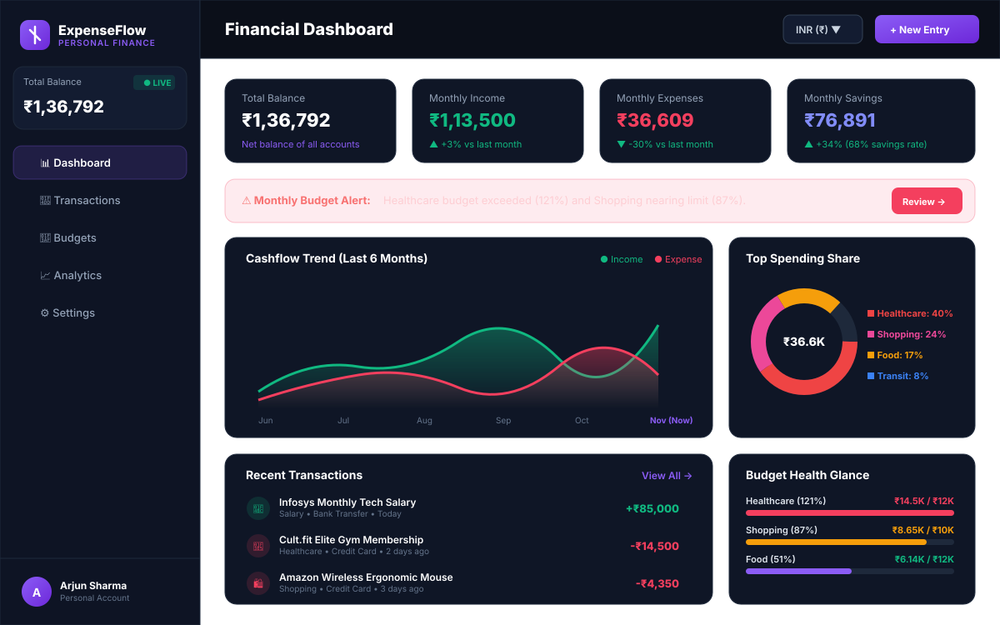

# 💎 ExpenseFlow – Personal Finance Manager

<p align="center">
  
</p>

<p align="center">
  <strong>A modern, high-performance, frontend-only personal finance dashboard and budgeting system.</strong><br>
  Built with <strong>React 18</strong>, <strong>Vite</strong>, <strong>Tailwind CSS</strong>, <strong>Recharts</strong>, and <strong>HTML5 LocalStorage</strong>.
</p>

<p align="center">
  
  
  
  
  
  
  
</p>

---

## 📑 Table of Contents

- [1. Executive Summary](#1-executive-summary)
- [2. Project Objectives & Constraints](#2-project-objectives--constraints)
- [3. Complete Feature Guide by Module](#3-complete-feature-guide-by-module)
  - [3.1 Dashboard (`/`)](#31-dashboard-)
  - [3.2 Transactions Ledger (`/transactions`)](#32-transactions-ledger-transactions)
  - [3.3 Category Budgets (`/budgets`)](#33-category-budgets-budgets)
  - [3.4 Analytics & Reports (`/analytics`)](#34-analytics--reports-analytics)
  - [3.5 Settings & Data Hub (`/settings`)](#35-settings--data-hub-settings)
- [4. Visual Showcase & Screenshots](#4-visual-showcase--screenshots)
- [5. Technical Architecture & Data Flow](#5-technical-architecture--data-flow)
- [6. Directory & Code Organization](#6-directory--code-organization)
- [7. Financial Calculation Engine & Standards](#7-financial-calculation-engine--standards)
- [8. UI/UX Design System](#8-uiux-design-system)
- [9. Responsive & Mobile Compatibility](#9-responsive--mobile-compatibility)
- [10. Setup & Execution Instructions](#10-setup--execution-instructions)
- [11. Submission Credentials](#11-submission-credentials)

---

## 1. Executive Summary

**ExpenseFlow** is an enterprise-grade, single-page application (SPA) designed to empower individuals with real-time financial tracking, budget discipline, and spending analytics. 

Adhering strictly to a **zero-backend, client-side only** architecture, the application requires no server setup, database configuration, or internet connectivity once loaded. It persists financial data entirely within the browser's `localStorage` engine while offering full CRUD transactions, automated multi-currency formatting, predictive caution alerts, dynamic charts, and CSV/JSON data portability.

---

## 2. Project Objectives & Constraints

| Parameter | Specification | Compliance Status |
|---|---|:---:|
| **Architecture** | 100% Frontend Only (No Express, MongoDB, Firebase, or external REST APIs) | ✅ Verified |
| **Persistence Engine** | HTML5 `localStorage` with non-destructive initial lazy-seeding | ✅ Verified |
| **Framework & Tooling** | React 18.3.1, Vite 5.4.6, React Router DOM 6.26.2 | ✅ Verified |
| **Data Visualization** | Interactive SVG Area, Bar, and Donut charts via Recharts | ✅ Verified |
| **Responsive Target** | Unified responsive codebase for Desktop, Tablet, and Mobile browsers | ✅ Verified |
| **Default Currency** | Indian Rupee (INR `₹`) with multi-currency selector support | ✅ Verified |
| **Default Aesthetic** | Deep Navy SaaS theme (`#0B0F19`) with violet accents | ✅ Verified |

---

## 3. Complete Feature Guide by Module

```
                          ┌─────────────────────────────────────┐
                          │    ExpenseFlow Application Shell    │
                          └──────────────────┬──────────────────┘
                                             │
      ┌──────────────────┬───────────────────┼───────────────────┬──────────────────┐
      ▼                  ▼                   ▼                   ▼                  ▼
┌───────────┐    ┌──────────────┐     ┌─────────────┐     ┌─────────────┐    ┌─────────────┐
│ Dashboard │    │ Transactions │     │   Budgets   │     │  Analytics  │    │  Settings   │
│ Overview  │    │    Ledger    │     │  & Targets  │     │  & Reports  │    │  & Backups  │
└───────────┘    └──────────────┘     └─────────────┘     └─────────────┘    └─────────────┘
```

### 3.1 Dashboard (`/`)
- **Executive Metric Cards**:
  - **Total Balance**: Real-time net wealth calculated as `Total Income - Total Expenses`.
  - **Monthly Income**: Income deposited within the active calendar month with month-over-month trend.
  - **Monthly Expenses**: Expenditure consumed within the active calendar month with inverted sentiment (spending drops show green; spending increases show red).
  - **Monthly Savings & Savings Rate**: Net retained surplus and calculated savings rate percentage `(Savings / Income) * 100`.
- **Cashflow Trend Chart**: 6-month interactive Area Chart illustrating historical cash inflows vs outflows with custom dark tooltips.
- **Top Spending Donut Chart**: Proportional breakdown of category expenditures for the current month.
- **Budget Health Widget**: Progress meter tracking aggregate budget consumption with one-click navigation to budget management.
- **Recent Transactions Feed**: Displays the 5 most recent transactions with quick-action links.
- **Quick Action Bar**: One-click triggers for **New Transaction** modal and **Export CSV**.

### 3.2 Transactions Ledger (`/transactions`)
- **Full CRUD Engine**: Add new transactions, edit existing transactions, and delete entries with safety confirmation dialogs.
- **Form Validation**: Strict client-side verification preventing negative or zero amounts, empty titles, and missing dates.
- **Data Attributes**: Title, Amount, Transaction Type (Income vs Expense), Category, Date, Payment Method (UPI, Credit Card, Debit Card, Net Banking, Cash, Bank Transfer), and Notes.
- **Instant Search**: Real-time filtering across titles, notes, categories, and payment channels.
- **Multi-Faceted Filters**:
  - Filter by Type: `All`, `Expenses`, `Income`
  - Filter by Category: 11 supported financial categories
  - Filter by Payment Method: UPI, Credit Card, Debit Card, Net Banking, Cash, Bank Transfer
  - Filter by Timeframe: `This Month`, `Last Month`, `Last 3 Months`, `Last 6 Months`, `This Year`, `All Time`
- **Sort Controls**: Newest date, Oldest date, Highest amount, Lowest amount, Title (A–Z).
- **Filtered Summary Ribbon**: Live summary badge reporting filtered transaction count, total inflows, total outflows, and net delta.
- **Pagination**: Clean 10-item page splitting with accessible previous/next navigation.
- **Receipt Details Modal**: Complete metadata view for any selected transaction.

### 3.3 Category Budgets (`/budgets`)
- **Category Spending Caps**: Set and edit monthly financial limits across categories.
- **Smart Caution Alert System**:
  - **Normal Status (`< 80%`)**: Violet/Emerald progress bar indicating safe spending.
  - **Warning Status (`80% – 99%`)**: Amber cautionary badge alerting the user that the budget limit is near.
  - **Exceeded Status (`≥ 100%`)**: Red pulse badge and banner highlighting budget overruns.
- **Budget Health Overview**:
  - Total Budget Allocated
  - Total Consumed
  - Safe-to-Spend Balance
  - Aggregate Percentage Meter

### 3.4 Analytics & Reports (`/analytics`)
- **Timeframe Selector**: Toggle metrics between `This Month`, `Last 3 Months`, `Last 6 Months`, `This Year`, and `All Time`.
- **Side-by-Side Monthly Bar Chart**: Direct monthly comparison of inflows vs outflows over the past 6 months.
- **Category Share Donut Chart**: High-contrast proportional donut chart with custom legends.
- **Cashflow Trajectory Chart**: Area trend showing cumulative cash movement.
- **Payment Channel Distribution**: Spending volume categorized by UPI, Credit Card, Debit Card, Net Banking, and Cash.
- **Detailed Category Breakdown Table**: Tabular breakdown showing category icon, transaction count, total expenditure, and visual share progress bars.

### 3.5 Settings & Data Hub (`/settings`)
- **Profile Customization**: Edit display name, email, and occupation with automatic avatar generation saved to `localStorage`.
- **Base Currency Selector**: Default **INR (`₹`)** with support for USD (`$`), EUR (`€`), GBP (`£`), CAD (`CA$`), AUD (`AU$`), JPY (`¥`), and AED (`AED`).
- **Theme Switcher**: Immediate one-click toggle between **Deep Navy Dark SaaS** (default) and **Clean Light** modes.
- **CSV Data Export**: Instant generation and download of `expenseflow_transactions.csv`.
- **JSON Backup & Restore**: Download complete state backups as `.json` and restore backups via client-side file picker.
- **Reset Sample Data**: Re-seeds the 20 realistic Indian transactions and default budgets with confirmation modal.
- **Wipe Local Database**: Two-step danger confirmation to completely clear `localStorage`.

---

## 4. Visual Showcase & Screenshots

High-fidelity vector previews are located in the [`screenshots/`](./screenshots/) directory:

| Screen | Description | Vector Asset |
|---|---|:---:|
| **01. Main Dashboard** | Executive KPI cards, cashflow trend area chart, top spending donut, recent transactions, and budget alert. | [View SVG](./screenshots/01-dashboard.svg) |
| **02. Transactions Ledger** | Multi-faceted filter toolbar, search bar, summary ribbon, and responsive transaction table. | [View SVG](./screenshots/02-transactions.svg) |

---

## 5. Technical Architecture & Data Flow

```
┌────────────────────────────────────────────────────────────────────────┐
│                        React Application Root                          │
│                               (App.jsx)                                │
└───────────────────────────────────┬────────────────────────────────────┘
                                    │ Wraps Context Providers
┌───────────────────────────────────▼────────────────────────────────────┐
│      ThemeProvider  ─►  CurrencyProvider  ─►  ToastProvider           │
│                                  │                                     │
│                     FinanceProvider (Core State)                       │
└───────────────────────────────────┬────────────────────────────────────┘
                                    │ Exposes State & Actions
      ┌─────────────────────────────┼─────────────────────────────┐
      ▼                             ▼                             ▼
┌──────────────┐             ┌──────────────┐             ┌──────────────┐
│  Dashboard   │             │ Transactions │             │   Budgets    │
│  Analytics   │             │   Filters    │             │   Warnings   │
└──────┬───────┘             └──────┬───────┘             └──────┬───────┘
       │                            │                            │
       └────────────────────────────┼────────────────────────────┘
                                    ▼ Dispatches Updates
┌────────────────────────────────────────────────────────────────────────┐
│                  Financial Calculation Engine                          │
│                    (src/utils/calculations.js)                         │
└───────────────────────────────────┬────────────────────────────────────┘
                                    │ Synchronizes
┌───────────────────────────────────▼────────────────────────────────────┐
│                     HTML5 LocalStorage Database                        │
│   (expenseflow_transactions, expenseflow_budgets, expenseflow_profile) │
└────────────────────────────────────────────────────────────────────────┘
```

---

## 6. Directory & Code Organization

```
ExpenseFlow/
├── public/                          # Static assets and icons
├── screenshots/                     # Vector UI screenshots and visual showcase
│   ├── 01-dashboard.svg             # Dashboard preview
│   ├── 02-transactions.svg          # Transactions ledger preview
│   └── README.md                    # Visual showcase guide
├── src/
│   ├── assets/                      # Application icons & branding
│   ├── components/
│   │   ├── analytics/               # Recharts visualization components
│   │   │   ├── CashflowChart.jsx           # Inflow vs outflow area chart
│   │   │   ├── CategoryPieChart.jsx        # Category breakdown donut chart
│   │   │   ├── ExpenseBreakdownTable.jsx   # Tabular category spending summary
│   │   │   └── MonthlyBarChart.jsx         # Monthly side-by-side bar chart
│   │   ├── budgets/                 # Budget management components
│   │   │   ├── BudgetCard.jsx              # Category budget card with caution states
│   │   │   ├── BudgetFormModal.jsx         # Modal to set/edit category limits
│   │   │   └── BudgetSummary.jsx           # Overall budget consumption header
│   │   ├── common/                  # Reusable UI primitives
│   │   │   ├── Badge.jsx                   # Status badges (income, expense, warning)
│   │   │   ├── Button.jsx                  # Standardized button variants
│   │   │   ├── Card.jsx                    # Glassmorphism container cards
│   │   │   ├── CategoryIcon.jsx            # Category icon mapping
│   │   │   ├── ConfirmDialog.jsx           # Two-step confirmation dialog
│   │   │   ├── EmptyState.jsx              # Fallback UI for empty queries
│   │   │   ├── Modal.jsx                   # Accessible modal overlay
│   │   │   └── StatCard.jsx                # Key performance indicator cards
│   │   ├── layout/                  # Shell components
│   │   │   ├── Layout.jsx                  # Main shell uniting sidebar, navbar, & outlet
│   │   │   ├── MobileNav.jsx               # Thumb-friendly mobile bottom navigation
│   │   │   ├── Navbar.jsx                  # Header with currency & theme switches
│   │   │   └── Sidebar.jsx                 # Desktop sidebar with live balance
│   │   └── transactions/            # Ledger components
│   │       ├── TransactionDetailsModal.jsx # Detailed receipt modal
│   │       ├── TransactionFilters.jsx      # Search, type, category, and date toolbar
│   │       ├── TransactionFormModal.jsx    # Add/Edit transaction with validation
│   │       ├── TransactionItem.jsx         # Adaptive transaction row/card
│   │       └── TransactionList.jsx         # Paginated transaction listing
│   ├── context/                     # React Context State Management
│   │   ├── CurrencyContext.jsx      # Multi-currency provider (INR default)
│   │   ├── FinanceContext.jsx       # Ledger state, calculations & persistence
│   │   ├── ThemeContext.jsx         # Dark / Light theme synchronization
│   │   └── ToastContext.jsx         # Animated toast notification manager
│   ├── data/                        # Initial datasets & configurations
│   │   ├── categories.js            # 11 supported financial categories
│   │   ├── currencies.js            # Currency configurations (INR, USD, EUR, etc.)
│   │   └── sampleData.js            # 20 realistic Indian seed transactions
│   ├── pages/                       # Application Views
│   │   ├── Analytics.jsx            # Analytics & reports page
│   │   ├── Budgets.jsx              # Monthly category budgets page
│   │   ├── Dashboard.jsx            # Main dashboard overview
│   │   ├── NotFound.jsx             # 404 error fallback page
│   │   ├── Settings.jsx             # Settings & backup management
│   │   └── Transactions.jsx         # Transactions ledger & search
│   ├── utils/                       # Pure Utility Functions
│   │   ├── calculations.js          # Financial metrics & aggregation engine
│   │   ├── exportCSV.js             # CSV generator & JSON backup exporter
│   │   └── formatters.js            # Currency, relative date & compact formatters
│   ├── App.jsx                      # App root with providers & React Router routes
│   ├── index.css                    # Tailwind CSS directives & scrollbar styling
│   └── main.jsx                     # Application DOM mounting entrypoint
├── .gitignore                       # Standard Git ignore rules
├── index.html                       # HTML5 template with Inter font
├── package.json                     # Project manifest and dependencies
├── postcss.config.js                # PostCSS plugins configuration
├── README.md                        # Documentation
├── tailwind.config.js               # Tailwind custom color palette & shadows
└── vite.config.js                   # Vite config with manual chunk splitting
```

---

## 7. Financial Calculation Engine & Standards

The application uses a pure calculation engine in [`src/utils/calculations.js`](./src/utils/calculations.js) that eliminates common JavaScript floating-point and date errors:

1. **Timezone-Immune Date Evaluation**:
   Date strings (`YYYY-MM-DD`) are decomposed into local year, month, and day integers rather than parsed via UTC timestamps, ensuring that transactions logged on the 1st of a month are never misassigned to the prior month due to UTC timezone offsets.
2. **Standard GAAP Growth Formulas**:
   Percentage change calculations support positive, zero, and negative baseline values:
   $$\text{Growth \%} = \frac{\text{Current} - \text{Previous}}{|\text{Previous}|} \times 100$$
   This ensures that transitioning from a negative savings balance (deficit) to a positive savings balance (surplus) correctly reflects positive growth.
3. **Sentiment-Aware Expense Trends**:
   For expenditure metrics, trend indicators invert standard growth colors: a decrease in expenses is colored **Emerald Green** (beneficial), while an increase in expenses is colored **Rose Red** (cautionary).

---

## 8. UI/UX Design System

| Role | Color Name | Hex Code | Purpose |
|---|---|---|---|
| **Background Dark** | Navy 900 | `#0B0F19` | Main application background |
| **Card Surface** | Navy 850 | `#0F1626` | Elevated cards, sidebars, and dialog surfaces |
| **Borders** | Navy 750 | `#1E293B` | Subtle card outlines and divider rules |
| **Brand Accent** | Violet 500 | `#8B5CF6` | Primary buttons, active tabs, and focus rings |
| **Income Indicator** | Emerald 500 | `#10B981` | Positive cashflow, deposits, and growth arrows |
| **Expense Indicator** | Rose 500 | `#F43F5E` | Negative cashflow, withdrawals, and over-budget states |
| **Warning Indicator** | Amber 500 | `#F59E0B` | 80%–99% budget caution indicators |

---

## 9. Responsive & Mobile Compatibility

ExpenseFlow is engineered as **one unified application** that dynamically adjusts layout across screen sizes:

- **Desktop (≥ 1024px)**: Fixed left navigation sidebar (256px), multi-column dashboard grid, full transaction data table.
- **Tablet (768px – 1023px)**: Two-column metric cards, responsive charts with automatic container reflow.
- **Mobile (< 768px)**:
  - Header displays a slide-over drawer toggle.
  - Sticky bottom navigation bar for single-thumb access to all 5 sections.
  - Transactions format into touch-friendly cards with tap targets (`min-h-[32px]`).
  - Charts utilize responsive containers with `min-w-0` to eliminate horizontal scroll.

---

## 10. Setup & Execution Instructions

### Prerequisites
- **Node.js**: v18.0.0 or higher
- **npm**: v9.0.0 or higher (or `pnpm` / `yarn`)

### Quick Start

```bash
# 1. Clone the repository or navigate to project directory
cd ExpenseFlow

# 2. Install dependencies
npm install

# 3. Launch development server with Hot Module Replacement (HMR)
npm run dev
```

Open your browser and navigate to:
```
http://localhost:5173
```

### Production Build

```bash
# Build optimized, minified production assets
npm run build

# Preview production build locally
npm run preview
```

Production assets are compiled into the `dist/` directory with code-splitting:
- `dist/assets/vendor-*.js` (React, React-DOM, React Router)
- `dist/assets/recharts-*.js` (Data visualization bundle)
- `dist/assets/icons-*.js` (Lucide React iconography)
- `dist/assets/index-*.js` (Application logic)
- `dist/assets/index-*.css` (Tailwind CSS stylesheet)

---

## 11. Submission Credentials

- **Project Title**: ExpenseFlow – Personal Finance Manager
- **Course**: Advanced Frontend Web Development / Web Engineering
- **Architecture**: Single-Page React Application (Zero-Backend, Frontend-Only)
- **Primary Currency**: Indian Rupee (INR `₹`)
- **Persistence Engine**: Client-side `localStorage` with automated JSON backup/restore
- **License**: MIT
